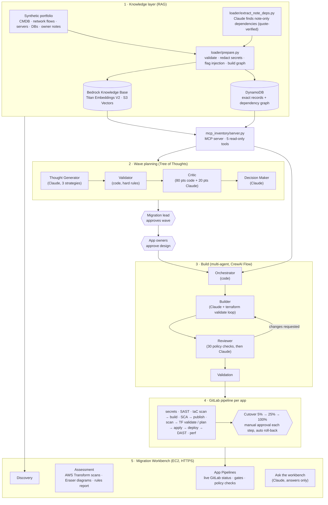

# Migration Workbench

**An agentic AI system that plans, checks and tracks the move of a company's applications from Oracle Cloud Infrastructure (OCI) to AWS, with people approving every decision that matters.**

Capstone project for the agentic AI program. **All data is synthetic.** "Harborview Insurance" is a fictional company; every application, server, person and note in this repository was generated by `synthetic_portfolio/generate.py`.

| | |
| --- | --- |
| **Problem** | Portfolio migrations stall in the work around each move: building an accurate inventory, finding dependencies, ordering waves, writing infrastructure code and pipelines, and proving each move is safe. |
| **Intended users** | Cloud migration engineers and architects, the migration lead who approves waves and cutovers, application owners, and managers who track progress. |
| **What it does** | Loads and cleans the inventory into a RAG knowledge base, plans migration waves with Tree-of-Thoughts search, generates and self-corrects Terraform and GitLab pipelines with a multi-agent flow, enforces ~30 deterministic policy checks and 10 pipeline security gates, and shows everything live on a secure web dashboard with an answers-only chat assistant. |
| **Core rule** | **AI assists, rules enforce, people decide.** No AI component can approve, apply, deploy or move traffic. |

- **User guide (non-technical, 16 sections):** [`dashboard/README.md`](dashboard/README.md)
- **Knowledge base setup in AWS:** [`README_CLOUDSHELL.md`](README_CLOUDSHELL.md)
- **Evaluation evidence:** [`docs/evaluation/`](docs/evaluation/)

---

## 1. Architecture



**How the parts fit together.** The knowledge layer is the single source of facts. Every agent reads it through the same read-only MCP tools, so the planner and the builder see identical data. The wave planner turns those facts into a scored, auditable wave plan that a person approves. The build flow turns each approved application into Terraform plus a GitLab pipeline, checked by deterministic policies and an independent AI review. GitLab runs the pipeline with short-lived AWS credentials (OIDC). The workbench dashboard reads the inventory, the scan results and live GitLab status, and is where people see and act on all of it.

### Agents and components

| Component | Type | Role | Can it change anything? |
| --- | --- | --- | --- |
| Note dependency extractor | Claude | Finds dependencies written only in owner notes | No. Proposals stay *unconfirmed* until a person confirms |
| Inventory MCP server | Tools | `search_apps`, `list_apps`, `get_app`, `get_dependencies`, `get_move_groups` | No. Read-only |
| Thought Generator / Critic / Decision Maker | Claude | Propose, score and compare wave plans | No |
| Validator | Code | Rejects plans that break capacity, freeze windows, security review or shared-service order | No |
| Orchestrator | Code (CrewAI Flow) | Runs the build stage, enforces approval gates, owns stage changes | Only along allowed stage transitions |
| Builder | Claude + Terraform | Writes `main.tf`, `outputs.tf`, `.gitlab-ci.yml`, migration notes; fixes its own `terraform validate` errors (max 3 tries) | Writes files only |
| Reviewer | Code + Claude | 30 deterministic policy checks first, then an independent AI review (max 2 cycles, then held for a person) | Approve or send back only |
| AWS Transform | AWS AI service | Read-only source code analysis | No |
| Rules checker | Claude | Compares scan reports with migration rules; every line must quote evidence | No |
| Ask the workbench | Claude | Grounded Q&A over the dashboard data | No. Answers only |

---

## 2. Repository layout

| Path | What it contains |
| --- | --- |
| `synthetic_portfolio/` | Deterministic generator for the 46-app synthetic portfolio, its answer key and the target mapping rules |
| `loader/` | RAG pipeline: prepare, note-dependency extraction, load to Bedrock/DynamoDB, retrieval tests |
| `terraform/` | Knowledge base infrastructure (S3, S3 Vectors, Bedrock KB, DynamoDB, least-privilege IAM, budget) |
| `mcp_inventory/` | Read-only MCP tool server over the knowledge base and graph |
| `wave_planner/` | Tree-of-Thoughts planner and deterministic validator; `out_run1/` holds a recorded run with its full trace |
| `migration_flow/` | Multi-agent build flow: orchestrator, Builder, Reviewer, Validation, message contracts, versioned plan store, deterministic target spec, policy engine (`policy.py`) and offline test (`test_local.py`) |
| `dashboard/` | The workbench web app: server, collectors, three pages, rules checker, architecture generator, chat assistant; user guide in `dashboard/README.md` |
| `scans/` | AWS Transform scan runner and sync, plus GitLab pipeline helpers (pilot and dry-run modes) |
| `gitlab_pilot/` | Pilot application's Terraform and pipeline push scripts |
| `sample_app/` | Eight synthetic legacy applications (Java, Node.js, COTS) used as Wave 1 |
| `workbench/` | Terraform for the EC2 host: IAM role, HTTPS-only security group, Session Manager access, nightly stop schedule |
| `architecture/` | Current and future architecture diagrams (Eraser diagram code) |
| `docs/evaluation/` | Saved outputs of the tests described in section 5 |

---

## 3. Review it in 10 minutes (no AWS account, no API key)

These steps run the deterministic parts and the full multi-agent build flow with a fake model and fake Terraform, so a reviewer can verify the behaviour locally.

```bash
git clone https://github.com/adavis912/migration-workbench.git
cd migration-workbench
python3 -m venv .venv && source .venv/bin/activate      # Windows: .venv\Scripts\activate
pip install -r requirements-review.txt

# 1. Generate the synthetic portfolio (deterministic: seed 20261117)
python synthetic_portfolio/generate.py
#    -> apps=46 servers=147 databases=32 ... move_groups=33 planted=16

# 2. Run the RAG preparation step locally (validate, redact, flag injection, build graph, chunk)
cd loader && python prepare.py --data ../synthetic_portfolio/data --out build && cd ..
#    -> 138 chunks, 1 redacted secret, 2 notes flagged for prompt injection, 1 CMDB conflict

# 3. Run the multi-agent build flow end to end with a fake model (18 checks)
cd migration_flow && python test_local.py ../synthetic_portfolio && cd ..
#    -> 18/18 passed
```

Then read:

- `wave_planner/out_run1/wave_plan.md` – a recorded Tree-of-Thoughts recommendation, and `tot_trace.json` – all 78 evaluated branches with scores and pruning reasons.
- `migration_flow/policy.py` – the ~30 deterministic checks (listed in Appendix A of the user guide).
- `dashboard/pipeline.html` and `dashboard/collector.py` – how live GitLab pipeline status becomes the App Pipelines page.

---

## 4. Deploy the full system (AWS)

Requires an AWS account (us-east-1) with Bedrock access to Titan Text Embeddings V2, an Anthropic API key, a GitLab group, and optionally an Eraser API key and AWS Transform access.

1. **Knowledge base.** Follow [`README_CLOUDSHELL.md`](README_CLOUDSHELL.md) from AWS CloudShell: `terraform/` creates the resources, `loader/` prepares and loads the data, `loader/test_kb.py` runs the 12 retrieval checks. (When following it, the data path in this repository is `../synthetic_portfolio/data`.)
2. **Secrets.** Store values in AWS Secrets Manager, never in code: `capstone/anthropic-api-key`, `capstone/eraser-api-key`, a GitLab token for the sample projects, and a GitLab `read_api` token for the dashboard collector. `capstone/dashboard-login` is created by the installer.
3. **Wave plan.** `python wave_planner/planner.py --outputs loader/tf_outputs.json --secret-id capstone/anthropic-api-key --out wave_planner/out`, then a person reviews `wave_plan.md`.
4. **Build flow.** `python migration_flow/flow.py --help`. Approvals are given with `flow.py approve ...`; nothing is built before the migration lead and each app owner approve.
5. **Workbench host.** `terraform -chdir=workbench apply -var code_bundle=<path to a tarball of this repo>` creates the EC2 host (no SSH; Session Manager only; HTTPS in only; nightly stop schedule). On the host, `sudo bash dashboard/install.sh` installs the HTTPS service.
6. **Pipelines.** `scans/push_app_pipeline.sh <APP>` pushes an app's generated pipeline to GitLab in plan-only pilot mode; `scans/dry_run_push.sh <APP>` enables every stage with apply/deploy/cutover as dry runs. GitLab reaches AWS through an OIDC role limited to `plan` (see `scans/trust_app_project.sh`).

Account IDs and resource IDs in this repository are placeholders (`111122223333`, `i-0123456789abcdef0`).

---

## 5. Evaluation summary

| Area | Evaluation criterion | Result | Evidence |
| --- | --- | --- | --- |
| RAG retrieval | 12 checks: 6 semantic questions whose answers exist only in free text, a metadata filter, redaction, injection flagging, record counts, exact lookup, move groups vs. answer key | **11 / 12 passed.** The miss: a "shared database" question ranked dependency summaries above POL-RATING. This is why exact dependency questions go to the DynamoDB graph, not vector search | `docs/evaluation/knowledge_base_retrieval_test.txt` |
| Data preparation | Planted data-quality and security issues are detected before anything reaches a model | Redaction 1/1, injection 2/2, CMDB conflict 1/1, decommissioned server 1/1, missing agent 1/1, 10 stale apps | `docs/evaluation/prepare_output.txt` |
| Wave planning (ToT) | Hard constraints never violated; full audit trail; blocked items named | 78 candidate evaluations within budget; PCI group without security review correctly held out; every pruning reason recorded | `wave_planner/out_run1/` |
| Build flow and guardrails | 18 behaviour checks: approval gates, policy rejection of unsafe code, self-correction, move-group integrity, field ownership, illegal stage transitions, message contracts | **18 / 18 passed** | `docs/evaluation/build_flow_offline_test.txt` |
| Real pipelines | Two Wave 1 apps (CS-SURV2, FIN-RPT-LEGACY) run all stages in GitLab in dry-run mode | 19 jobs passed per app; real security scans and Terraform plans (41 and 22 resources to add); cutover stops for manual approval | GitLab pipelines; App Pipelines page |
| Pilot | CLM-FRAU1 runs plan-only; scan findings feed back into the policy engine | ALB-TLS and CACHE-AUTH findings reproduced offline, remediated version passes | `test_local.py` check 5 |

---

## 6. Safety, reliability and human oversight

- **Human gates:** wave approval, per-app design approval and every cutover step need a named person. Approvals are tied to a hash of the exact plan or design; any change invalidates them.
- **Deterministic enforcement:** stage order, pass/fail of ~30 policy checks and 10 blocking pipeline gates are code, not AI judgment. The AI cannot override a failed check.
- **Least privilege:** MCP tools are read-only; each agent writes only its own fields; only the Orchestrator changes stages; GitLab uses short-lived OIDC credentials limited to `plan`; the host has no SSH and reads only the secrets it needs.
- **Grounding:** answers come only from supplied data; quotes are verified against sources and unproven lines removed; verdicts are recomputed by code.
- **Prompt-injection defense:** planted attacks in owner notes are flagged at load time, labelled as data in every prompt, and kept off web pages; tools cannot act even if an agent were fooled.
- **Reliability and cost:** structured outputs with schema validation, retry on truncation, call budgets (80 per build run, 60 per plan, 50 chat questions per day), graceful fallback to last good data, nightly host shutdown.

## 7. Limitations

- All data is synthetic; real CMDB and network data would be messier.
- Apply, deploy and cutover run as dry runs; no production infrastructure is created.
- The recorded planner run produced one complete plan, so the Decision Maker had no runner-up to compare, and only Wave 1 received a business-fit critique.
- One semantic retrieval check still fails; the system depends on the graph for completeness.
- The dashboard uses a self-signed certificate and a single shared login.

## 8. How the design evolved

| Checkpoint | Change |
| --- | --- |
| 1.1 | Problem framed: replatform migration agent; why a single prompt is not enough |
| 2.1 | ReAct loop, short- and long-term memory, AWS Transform and CI/CD as tools |
| 3.1 | RAG knowledge base, plus exact filters and a dependency graph because top-k can miss links |
| 4.1 | Tree-of-Thoughts only for wave planning; ReAct elsewhere |
| 5.1 | Six-agent architecture with a central orchestrator, contracts and field ownership |
| 6.1 | Layered guardrails and human intervention points |
| Final | Built and deployed: secure workbench, live GitLab pipelines, AWS Transform scans, evidence-checked rules report, answers-only chat |
